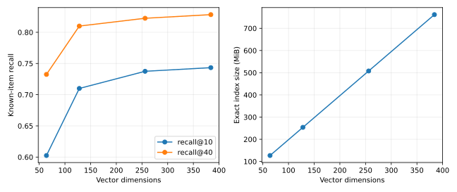
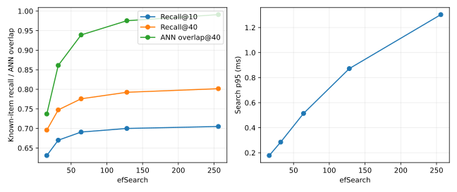

# E2 — Verified results in one place

This page combines the completed A/B/C and D1–D3 experiments. The
[methodology map](METHODOLOGY.md) explains the artifact paths and timing
boundaries. All retrieval quality figures below use the **same frozen C2
test**: 1,200 titles from the 520,000-question StackSample corpus, with each
title's own indexed question body as its **one judged positive**. These are
known-item metrics; unjudged documents may still be useful. The RAG results
use a different 28-question test and measure answer/abstain behavior, not
answer correctness.

## Retrieval quality and raw-title cost · A1–A3

The [A3 paired table](../results/evaluation/a3_test_paired_per_query.csv)
recomputes all 1,200 test ranks. Its [system table](../results/evaluation/a3_test_system_table.csv)
and [fixed settings](../configs/fair_comparison.json) give the values below.
Dense uses exact Flat-384, BM25 uses body-only SQLite FTS5, and hybrid uses
their depth-40 RRF with constant 60. The p50/p95 columns time the **same
100 raw-title queries** after three warmups: tokenization for BM25, MiniLM
encoding for dense, and both plus fusion for hybrid. Corpus fetch,
reranking and generation are excluded. This is a single sequential run.

| Strategy | Recall@10 | Recall@40 | MRR@10 | Raw-title p50 / p95 ms |
| --- | ---: | ---: | ---: | ---: |
| BM25 | 0.627500 | 0.726667 | 0.498723 | 336.531 / 596.505 |
| Exact dense | 0.743333 | 0.828333 | 0.587885 | 52.758 / 56.232 |
| Hybrid RRF | 0.772500 | 0.849167 | 0.609828 | 393.128 / 653.776 |

The hybrid minus dense Recall@10 difference is **+0.029167**, or 2.92
percentage points. The [C3 per-query differences](../results/evaluation/c3/per_query.csv),
[result](../results/evaluation/c3/results.json), and
[bootstrap config](../configs/error_analysis.json) show 78 paired gains and
43 losses at top 10. A query-level paired percentile bootstrap, with 10,000
resamples and seed 20260714, gives a **95% interval [+0.010833,
+0.046667]**. Recall@40 difference is +0.020833 with interval
[+0.007500, +0.034167]. These intervals describe this known-item sample;
they are not evidence of better answers or a population-wide claim about
new user questions. Slice results were descriptive, without a multiple-test
correction.

## Reranking and vector-search choices · A4, B1–B3

The [A4 saved per-query scores](../results/evaluation/a4_test/per_query.jsonl.gz)
and [result table](../results/evaluation/a4_test/results_table.csv) rerank
the **same top-40 lists** from A3 with a cross-encoder. With vote bonus off,
Recall@10 changes as follows on the same 1,200 titles:

| Candidate generator | Before | Title + body | Body only | Candidate Recall@40 ceiling |
| --- | ---: | ---: | ---: | ---: |
| BM25 | 0.627500 | 0.726667 | 0.677500 | 0.726667 |
| Exact dense | 0.743333 | 0.828333 | 0.757500 | 0.828333 |
| Hybrid RRF | 0.772500 | 0.848333 | 0.751667 | 0.849167 |

The title-plus-body input includes the indexed question's title, which is
also the known-item query. Its near-ceiling scores benefit from that direct
match; body-only hybrid actually fell below its pre-rerank Recall@10. A4's
GPU p50/p95 of **290.894/321.754 ms** is one query's **shared union** of
candidate pairs for the title-plus-body mode, with retrieval, corpus fetch
and model loading excluded. It is not a per-strategy or full-RAG cost.

The [B1 comparison](../results/evaluation/b1/comparison.csv) uses exact
FlatIP in each dimension, with vectors normalized after PCA. The same
1,200 known-item titles determine Recall@10. Search p95 times **100
single-query FAISS calls on precomputed vectors**, excluding query encoding,
index loading and corpus fetch. The index column is file size, not process
memory.

| Dimensions | Recall@10 | Index MiB | Search p95 ms |
| ---: | ---: | ---: | ---: |
| 384, no PCA | 0.743333 | 761.72 | 80.618 |
| 256 | 0.737500 | 507.81 | 47.200 |
| 128 | 0.710000 | 253.91 | 17.834 |
| 64 | 0.602500 | 126.95 | 8.859 |



B1's 384→128 loss is **0.033333 Recall@10** under exact search. B2 then
holds the 128-dimensional vectors fixed: its [paired table](../results/evaluation/b2/comparison.csv)
shows exact Recall@10 **0.710000** versus HNSW **0.700000**, a further
**0.010000** loss from ANN approximation. At 128 dimensions, exact/HNSW
search p95 is **18.108/0.715 ms** and HNSW's exact-top-10 overlap is
**0.989750**. These are search-only times on precomputed vectors for the
same 100 frozen titles, not complete query or answer latency.

The [B3 efSearch sweep](../results/evaluation/b3/comparison.csv) reuses
B2's HNSW-128 index and all 1,200 known-item judgments. Search p95 again
times 100 sequential top-40 FAISS searches on precomputed vectors after
three warmups. Changing `efSearch` trades search time for recall; the
configured value is 128.

| efSearch | Recall@10 | Exact top-10 overlap | Search p95 ms |
| ---: | ---: | ---: | ---: |
| 16 | 0.630833 | 0.865167 | 0.178 |
| 32 | 0.670000 | 0.936583 | 0.285 |
| 64 | 0.690833 | 0.973583 | 0.514 |
| **128** | **0.700000** | **0.989750** | **0.872** |
| 256 | 0.705000 | 0.995667 | 1.303 |



The B1, B2 and B3 p95 numbers come from **separate runs** with their own
timing protocols. Compare quality within the fixed query set, but use each
documented paired run for a latency claim. Choosing a new `efSearch` from
these test outcomes would tune on the test split.

## Build, memory and corpus fetch · B4

The [B4 resource table](../results/evaluation/b4/resource_table.csv),
[phase JSON files](../results/evaluation/b4/), and
[configuration](../configs/resource_profile.json) cover the full 520,000
vectors on one CPU laptop. Build seconds time adding vectors to FAISS;
serialization is excluded. Build RSS is measured in a fresh build process.
Runtime RSS includes the encoder, index and corpus access. Runtime search
and 40-row Parquet-fetch p95 values are from the **first warmed round of
100 frozen titles**; that path excludes reranking and generation.

| System | Build add s | Build peak RSS MiB | Index MiB | Runtime peak RSS MiB | Search p95 ms | Fetch 40 p95 ms |
| --- | ---: | ---: | ---: | ---: | ---: | ---: |
| Flat-384 | 0.827 | 1,740.87 | 761.72 | 4,314.00 | 62.643 | 596.498 |
| Flat-128 | 0.242 | 724.99 | 253.91 | 3,951.97 | 17.284 | 561.447 |
| HNSW-128 | 64.437 | 819.80 | 325.45 | 3,926.91 | 0.933 | 574.776 |

HNSW's sub-millisecond search did **not** make time to fetched rows
sub-millisecond: its p95 there was **586.751 ms**. The index file size did
not predict its **3,926.91 MiB** process peak. GPU VRAM was unavailable,
not measured as zero.

## RAG behavior, citation format and complete latency · D1–D3

The [D1 fixture audit](../results/evaluation/d1/fixture_audit.json) checked
11 deliberately chosen citation-gate cases **without Ollama**. Ten returned,
four of those used extractive fallback, one raised a synthetic generator
error, and two final outputs still had invalid 0/0 citation metrics. The
gate accepts an unsupported claim with a syntactically valid `[1]` marker.
These counts are diagnostic fixtures, not a fallback or correctness rate.

The separate [D2 test trace](../results/evaluation/d2/run_local_b1b2/test.jsonl)
and [summary](../results/evaluation/d2/run_local_b1b2/summary.json) use
20 indexed StackSample titles labeled *answer* and eight plainly
nonprogramming controls labeled *abstain*. A raw reranker-score threshold
of **2.803920269** was selected on **20 calibration questions** before
the 28-question test. D2 matched all **28/28** simple behavior labels
(20/20 titles answered; 8/8 controls abstained), used fallback on **14/20**
returned answers, and recorded **0 errors**. Complete-call p50/p95 was
**3.657/6.036 s** on all 28 calls, including abstentions. This does not
score answer correctness or claim-to-source support.

The [D3 per-strategy traces](../results/evaluation/d3/run_local_b1b2/)
and [summary](../results/evaluation/d3/run_local_b1b2/summary.json) use
those **same 28 labels** with the reranker, threshold, top-three evidence,
prompt, Qwen settings and citation gate fixed. Each strategy supplied 40
candidates: B2 HNSW-128 dense, body-only BM25, or RRF of both. Unlike
A2/A3, this hybrid's dense branch is HNSW-128. The **raw/final citation
validity means** below divide by returned answers, while behavior and
complete latency divide by all 28 test calls. Fallback divides by
returned answers. All measured latencies are sequential on the local CPU.

| D3 strategy | Behavior matches | Answers / controls abstained | Fallback / answers | Raw / final citation-number validity mean | Candidate retrieval p50 / p95 ms | Complete p50 / p95 s |
| --- | ---: | ---: | ---: | ---: | ---: | ---: |
| Dense HNSW | 28/28 | 20/20 · 8/8 | 13/20 | 0.450 / 1.000 | 10.1 / 23.7 | 3.599 / 5.083 |
| BM25 | 27/28 | 19/20 · 8/8 | 14/19 | 0.316 / 1.000 | 384.9 / 709.8 | 4.098 / 6.159 |
| Hybrid RRF | 28/28 | 20/20 · 8/8 | 12/20 | 0.540 / 1.000 | 403.4 / 732.1 | 3.988 / 6.695 |

There were **0 generator and 0 pre-generation errors** in D3. BM25
abstained on one additional programming title because its top source's raw
reranker score fell below the fixed threshold. The final citation-number
means describe **number format**, not whether an answer is supported. Each
of BM25 and hybrid changed the final answer string on 10/28 queries versus
dense; no human correctness labels exist. Differences of one or two
fallbacks on 20 answers and these single-run latency gaps do not establish
a reliable advantage. The six-query repeat in the [D3 protocol](RAG_RETRIEVER_COMPARISON.md)
showed some raw generation variation despite fixed seed and temperature 0.

## Reproduce and interpret

From the repository root, with the committed per-query outputs and project
dependencies installed, run:

```bash
PYTHONPATH=src python scripts/verify_results_summary.py
```

The verifier recalculates retrieval and reranking Recall from saved ranks,
C3's paired bootstrap interval, D1 fixture counts, and D2/D3 summaries from
saved JSONL. It checks B4's phase files against its table and verifies the
cited config hashes. The linked A3/B1–B4 tables contain measured latency,
build and memory figures; raw timing samples were not committed for every
phase, so those values are cross-checked against saved phase summaries rather
than independently retimed. Re-running the model experiments requires the
local corpus, indexes and models; commands are in each task's linked protocol.
None of these results demonstrates factual answer accuracy, citation support,
or a whole-pipeline speedup from HNSW alone.
